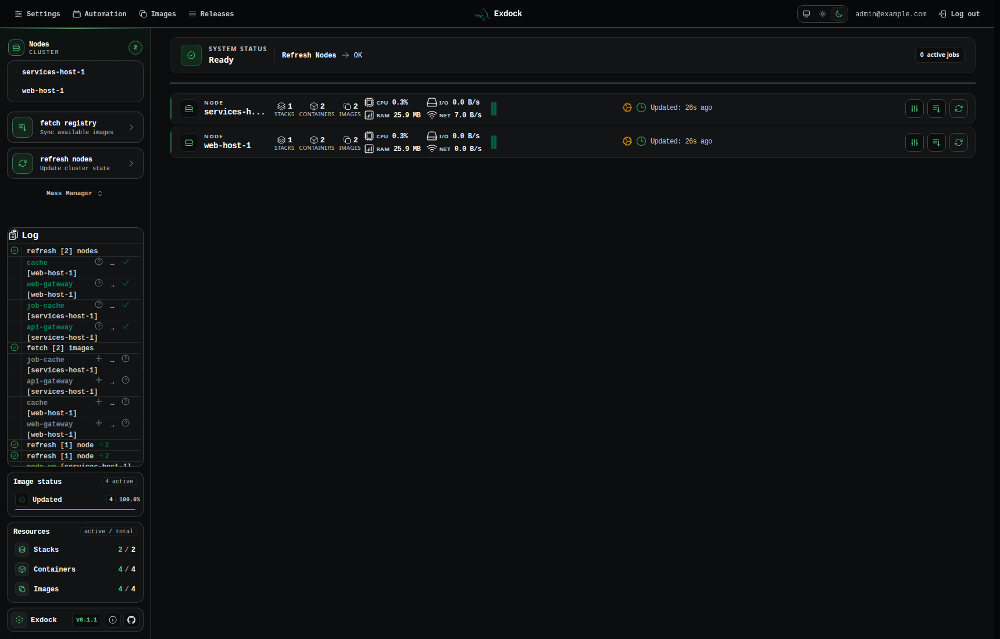
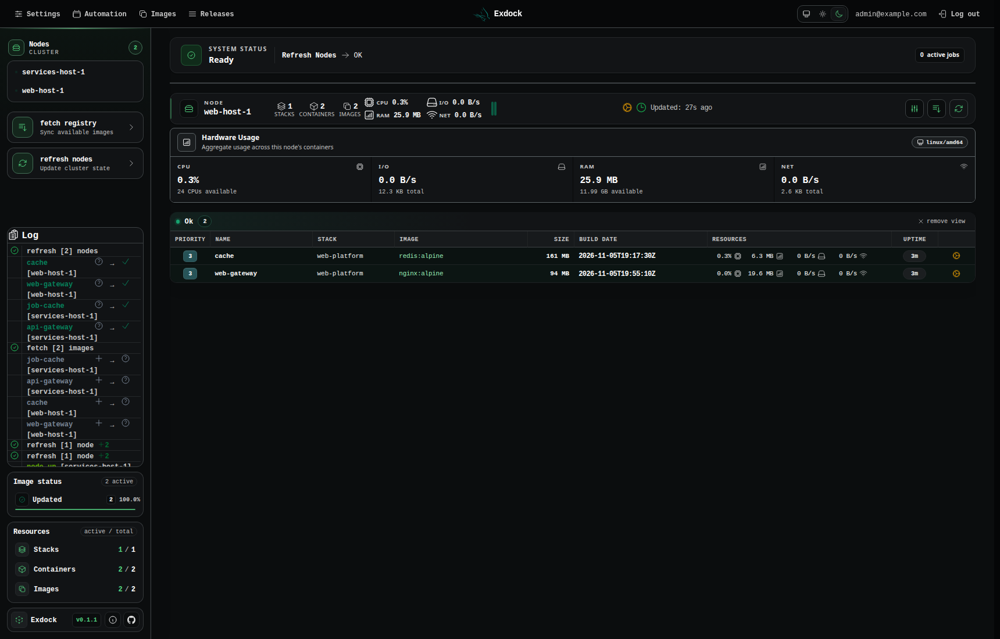
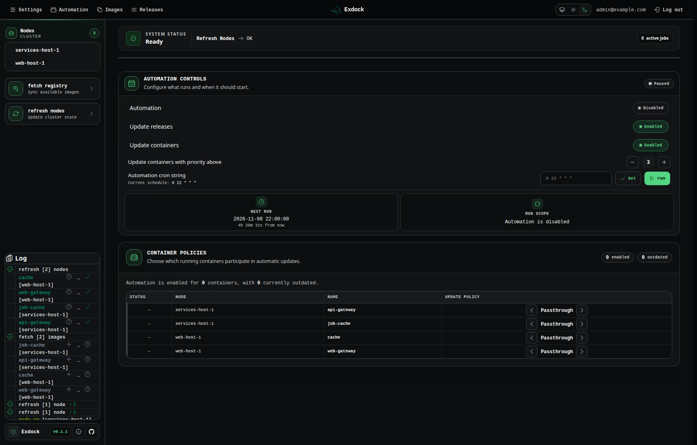

# Exdock

A multi-node dashboard for Docker containers.
A Phoenix/LiveView server presents the dashboard; an agent on each Docker host
connects to the server and executes commands.

- Start, stop, and restart containers; recreate them or pull and update their images.
- Browse images, container logs, and resource usage across connected hosts.
- Track registry updates and repository releases.
- Schedule automatic updates with per-container priorities and preferences.

## Deployment

Use a Linux host with Docker Engine, Docker Compose v2, and OpenSSL. The example
runs the server and an agent for the local Docker host, persists the database,
and exposes the dashboard at [http://localhost:4000](http://localhost:4000).

Agents control Docker through its socket. Keep the agent listener on a trusted
private network or VPN: its TLS connection currently does not verify the server
certificate. Exdock has one administrator account. See [SECURITY.md](SECURITY.md)
for the deployment trust boundary.

### Configure secrets

Copy [.env.example](.env.example) to `.env` in your installation directory:

```sh
cp .env.example .env
chmod 600 .env
```

Set `UI_EMAIL`, a strong `UI_PASSWORD`, and a unique `NODE_NAME`. Generate each
secret independently and paste its output into the matching `.env` field:

```sh
# SECRET_KEY_BASE
openssl rand -hex 64
# DB_VAULT_KEY: must decode to exactly 32 bytes
openssl rand -base64 32
# AUTH_KEY: shared by the server and its agents
openssl rand -hex 32
# UI_PASSWORD
openssl rand -hex 24
```

Keep `DB_VAULT_KEY` with your backups; changing or losing it makes stored
container configuration unreadable. Keep `.env` private.

For published images, add the image namespace and a matching **published**
server/agent tag to `.env`, for example:

```dotenv
EXDOCK_IMAGE_PREFIX=ghcr.io/c2bw/exdock
EXDOCK_RELEASE_TAG=v0.1.1
```

The version above is an example; use an available release from your registry.
If the images have not been published, use the source-build option below.

### Docker Compose example

Save this as `compose.release.yml`, or use the
[included file](compose.release.yml). Both services use the same release tag.

```yaml
# Pull a published server/agent pair from the same release. See docs/RELEASING.md.
services:
  server:
    image: "${EXDOCK_IMAGE_PREFIX:?Set the ghcr.io/owner/repository prefix}:${EXDOCK_RELEASE_TAG:?Set the published release tag}"
    labels:
      exdock.protected: "true"
    restart: unless-stopped
    environment:
      PHX_HOST: "${PHX_HOST:-localhost}"
      PORT: "4000"
      TCP_PORT: "5000"
      DATABASE_PATH: /data/db/exdock.db
      SECRET_KEY_BASE: "${SECRET_KEY_BASE:?Set SECRET_KEY_BASE in .env}"
      DB_VAULT_KEY: "${DB_VAULT_KEY:?Set DB_VAULT_KEY in .env}"
      AUTH_KEY: "${AUTH_KEY:?Set AUTH_KEY in .env}"
      UI_EMAIL: "${UI_EMAIL:?Set UI_EMAIL in .env}"
      UI_PASSWORD: "${UI_PASSWORD:?Set UI_PASSWORD in .env}"
      TZ: "${TZ:-Etc/UTC}"
    ports:
      - "127.0.0.1:${UI_PORT:-4000}:4000"
    volumes:
      - exdock_data:/data/db
  client:
    image: "${EXDOCK_IMAGE_PREFIX:?Set the ghcr.io/owner/repository prefix}_client:${EXDOCK_RELEASE_TAG:?Set the published release tag}"
    labels:
      exdock.protected: "true"
    restart: unless-stopped
    depends_on:
      - server
    environment:
      NODE_NAME: "${NODE_NAME:-docker-host-1}"
      SERVER_HOST: server
      SERVER_PORT: "5000"
      AUTH_KEY: "${AUTH_KEY:?Set AUTH_KEY in .env}"
    volumes:
      - /var/run/docker.sock:/var/run/docker.sock
volumes:
  exdock_data:
```

Validate the configuration, pull the images, and start both services:

```sh
docker compose -p exdock --env-file .env -f compose.release.yml config --quiet
docker compose -p exdock --env-file .env -f compose.release.yml pull
docker compose -p exdock --env-file .env -f compose.release.yml up -d
docker compose -p exdock --env-file .env -f compose.release.yml logs --tail=100 server client
```

Sign in with `UI_EMAIL` and `UI_PASSWORD`. The agent connects using the `server`
service name and appears as `NODE_NAME` after its first refresh. Both Exdock
services carry the `exdock.protected` label to prevent their recreation through
the dashboard. The database lives in the `exdock_exdock_data` volume; keep the
`-p exdock` project name consistent across commands.


For access through a domain, configure an HTTPS reverse proxy, set `PHX_HOST`
to the hostname, and forward WebSockets and `X-Forwarded-Proto: https`.

### Build from source

From a checkout of this repository, configure `.env` as above and use
[compose.quickstart.yml](compose.quickstart.yml) instead. Published images and
`EXDOCK_IMAGE_PREFIX` / `EXDOCK_RELEASE_TAG` are not required:

```sh
docker compose -p exdock --env-file .env -f compose.quickstart.yml config --quiet
docker compose -p exdock --env-file .env -f compose.quickstart.yml up -d --build
```

Use that Compose file for subsequent stop, upgrade, and backup commands.

## Screenshots

Dark mode captures from a demo instance with two connected Docker hosts
running Nginx and Redis containers.







## Add another Docker host

Deploy the matching agent image on each additional host. Create a private
`.env.agent` from [.env.agent.example](.env.agent.example), set a unique
`NODE_NAME`, and point `SERVER_HOST` / `SERVER_PORT` to the server's private/VPN
address and agent port. Copy only the shared `AUTH_KEY` to that host.

The deployment above keeps port `5000` inside its Compose network. To accept
remote agents, save this as `compose.remote.yml` on the server and set
`AGENT_BIND_IP` to its private/VPN interface address in `.env`:

```yaml
services:
  server:
    ports:
      - "${AGENT_BIND_IP:?Set the server private/VPN IP}:5000:5000"
```

```sh
docker compose -p exdock --env-file .env -f compose.release.yml -f compose.remote.yml up -d
```

Allow this port only from your agent hosts. Then, on the additional Docker host,
replace `YOUR_RELEASE_TAG` with the same published tag as the server:

```sh
chmod 600 .env.agent
docker run -d --name exdock-agent --restart unless-stopped \
  --label exdock.protected=true \
  --env-file .env.agent \
  -v /var/run/docker.sock:/var/run/docker.sock \
  ghcr.io/c2bw/exdock_client:YOUR_RELEASE_TAG
```

For source deployments, build the agent from the same checkout using
`docker build -f lib/exdock_client/Dockerfile -t exdock-agent:local .`, then use
`exdock-agent:local` in the command above and `compose.quickstart.yml` on the
server. See the [agent guide](lib/exdock_client/README.md) for naming rules,
configuration, and compatibility.

## Configuration

Compose only passes variables listed under a service's `environment`. Adding an
optional variable to `.env` also requires an entry in the service configuration.

| Variable | Purpose |
| --- | --- |
| `SECRET_KEY_BASE` | Server session-signing secret. |
| `DB_VAULT_KEY` | Base64-encoded 32-byte encryption key; preserve with the database. |
| `AUTH_KEY` | Shared server/agent authentication secret. |
| `UI_EMAIL`, `UI_PASSWORD` | Administrator login, applied at server startup. |
| `PHX_HOST`, `UI_PORT` | Browser hostname and loopback web port; defaults: `localhost`, `4000`. |
| `NODE_NAME` | Unique identity for each Docker host. |
| `TZ` | Server timezone; default: `Etc/UTC`. |
| `TRUSTED_PROXY_IPS` | Optional comma-separated proxy IPs trusted for forwarded login addresses. |
| `GITHUB_API_TOKEN`, `LOKI_URL` | Optional GitHub release-lookup token and Loki logging endpoint. |
| `RECREATE_READINESS_TIMEOUT_MS` | Agent recreation-readiness deadline; default: `30000`, `0` disables verification. |

The example fixes the database path at `/data/db/exdock.db` and the agent port
at `5000`. Agents use `SERVER_HOST` / `SERVER_PORT` to connect. If you replace
the database volume with a bind mount, its directory must be writable by the
server's unprivileged user, including SQLite journal creation.

## Updates and backups

Back up before upgrading. For published images, set the new matching release tag
in `.env`, then pull and recreate both services:

```sh
docker compose -p exdock --env-file .env -f compose.release.yml pull
docker compose -p exdock --env-file .env -f compose.release.yml up -d
```

For source builds, check out the new revision and run `up -d --build` with
`compose.quickstart.yml`. Upgrade remote agents to the matching release too.
Include any override files on every command. Database migrations run at server
startup; rollback across schema changes requires the older images and backup.

Updating the server alone does not update the full agent. The server delivers
only four `Exdock.AgentRuntime` modules when an agent connects. Docker support
code, including image inspection and dangling-image handling, is packaged in
the agent image. Pull and recreate every agent, or rebuild and recreate it for
source deployments, to receive those fixes. See the
[agent upgrade guide](lib/exdock_client/README.md#deployment-and-upgrades).

Use `stop` to pause Exdock and `up -d` to resume it. Managed workloads keep
running while Exdock is stopped. Avoid `down -v` unless you intend to delete the
database volume.

### Back up

Follow the [backup and restore guide](docs/BACKUP_RESTORE.md) to archive the
database and matching secrets, then verify recovery into a separate volume.
Exdock backups do not include managed workloads' own data or volumes.

## Development

Use Elixir `1.20.2` and Erlang/OTP `29.0.4`, matching CI, plus the native build
tools required by the dependencies:

```sh
mix setup
(cd lib/exdock_client_runtime && mix deps.get)
(cd lib/exdock_client && mix deps.get)
mix phx.server
```

Local development defaults to `admin@example.com` / `admin` at
[http://localhost:4000](http://localhost:4000). An agent must be started separately;
see the [agent guide](lib/exdock_client/README.md).

```sh
mix precommit
# Requires Docker; builds and tests production releases in an isolated Engine.
mix test.release
```

See [Docker testing](integration/docker/README.md), the
[project specification](docs/PROJECT_SPEC.md),
[protocol contract](lib/exdock_client/exdock_protocol/README.md),
[release guide](docs/RELEASING.md), and
[GitHub maintainer guide](docs/GITHUB_MAINTENANCE.md) for details.

## Troubleshooting

| Symptom | Check |
| --- | --- |
| Required variable is missing | Fill the secret fields in `.env`, use `--env-file .env`, and run `config --quiet`. |
| Image cannot be pulled | Verify that both packages and the selected release tag are published and accessible, or build from source. |
| Server restarts immediately | Check logs for missing variables, an invalid vault key, or database-directory permissions. |
| Browser cannot connect | Check `docker compose ps`, `UI_PORT`, and the SSH tunnel when connecting remotely. |
| HTTPS redirects or LiveView disconnects behind a proxy | Match `PHX_HOST` to the browser hostname; forward HTTPS scheme and WebSockets. |
| Login fails | Use the configured credentials. Apply changes with `up -d`; `restart` does not reload environment variables. |
| No connected node | Check client logs, `AUTH_KEY`, unique node names, and network reachability. An agent container's `localhost` points to itself. |
| Protocol/version mismatch | Deploy compatible server and agent images together. |
| Agent cannot access Docker | Mount `/var/run/docker.sock`; the entrypoint grants the runtime user the socket's group access. |
| Encrypted configuration cannot be read after restore | Restore the `DB_VAULT_KEY` belonging to that database. |
| Recreation fails readiness checks | Check replacement logs/healthcheck; increase the agent readiness timeout for slow startup if needed. |

When reporting an issue, include the release tag or source revision, Docker
version, affected operation, and relevant logs. Remove credentials, tokens, and
sensitive container configuration before sharing output.

## License

[MIT](LICENSE).
